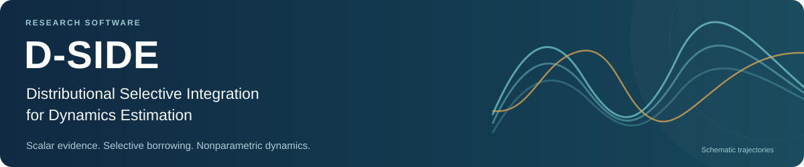
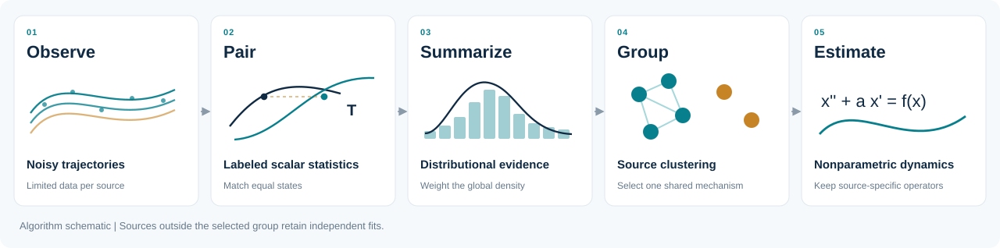
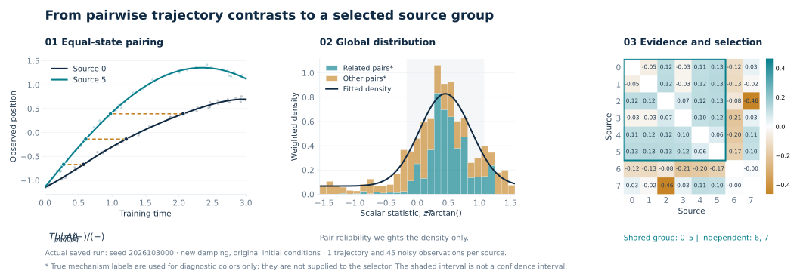
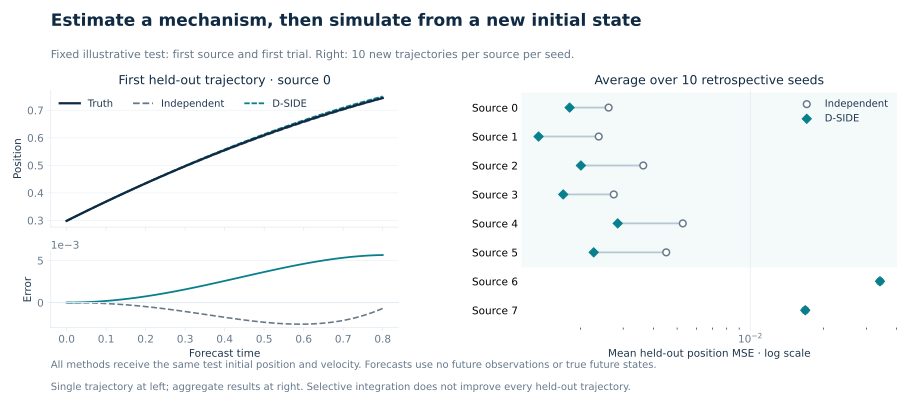

<p align="center">
  
</p>

<p align="center">
  <strong>Selective information sharing across systems with heterogeneous governing dynamics.</strong>
</p>

<p align="center">
  <a href="#the-idea">The idea</a> ·
  <a href="#inside-the-algorithm">The algorithm</a> ·
  <a href="#quick-start">Quick start</a> ·
  <a href="#simulation-evidence">Evidence</a> ·
  <a href="docs/reproduce.md">Reproduce</a> ·
  <a href="docs/README_zh.md">中文</a>
</p>

---

## The idea

One short trajectory can provide too little information to estimate a system's dynamics reliably. Combining sources can help—but only when their governing mechanisms are sufficiently similar.

**D-SIDE** uses distributions of scalar trajectory contrasts to select sources for joint, nonparametric dynamics estimation. Sources outside the selected group retain their independent fits.

The heterogeneity is in the **equations themselves**: both operator coefficients and nonlinear functions can vary across sources. Initial conditions may also differ, but they do not define the source groups.

$$
Y_{gj}=X_g(t_{gj})+\epsilon_{gj},
\qquad
X_g''(t)+a_gX_g'(t)=f_g\{X_g(t)\}.
$$

Here, $g$ indexes sources, $a_g$ is a source-specific damping coefficient, and $f_g$ is an unknown smooth function. The selected sources share a common function while retaining separate coefficients.



**Release scope:** scalar second-order systems; one training trajectory per source; at most nine sources with exact partition search. This repository is a simulation-validated research prototype.

## Inside the algorithm

**Pair trajectories at equal states.** Smooth each training curve, form regularized integral coordinates, and compute a scalar contrast at matched positions:

$$
T_{pq}=\frac{b_q-b_p}{A_p-A_q}.
$$

Each contrast retains its two source labels. Velocity and denominator checks remove poorly conditioned pairs. The statistic is a dynamical comparison feature; across heterogeneous sources, it is not an unbiased estimate of a shared damping coefficient.

**Build distributional evidence.** Fit a peak-plus-background model to the transformed contrasts. A bounded source-pair reliability mass weights the **global distribution only**; graph edges are not multiplied by this mass again.

**Select and estimate.** Correlation clustering produces a partition. The highest-scoring block with at least three sources is fitted jointly using a shared Matérn-kernel function and separate operator coefficients. Other sources keep independent models. New trajectories are generated by free ODE simulation from supplied initial positions and velocities.



*Actual saved example: eight sources, one training curve and 45 noisy position observations per source. Ground-truth colors are used only for post-hoc interpretation. The shaded peak region is descriptive, not a confidence interval.*

[Mathematical definition and defaults →](docs/method.md)

## Quick start

Use **Python 3.8–3.11**. Python 3.10 or 3.11 is recommended for a new environment. No GPU, external dataset, or model download is required.

```bash
git clone https://github.com/s20011208/D-SIDE.git
cd D-SIDE
python -m venv .venv
source .venv/bin/activate
python -m pip install --upgrade "pip==24.3.1" "setuptools==75.3.2" "wheel==0.45.1"
python -m pip install -r requirements.lock.txt
python -m pip install -e . --no-deps --no-build-isolation
OPENBLAS_NUM_THREADS=1 OMP_NUM_THREADS=1 dside demo --output runs/demo
```

The example replays historical seed **2026103000** with the original initial-condition design and updated damping coefficients. It fits the models before creating the test trajectories, then writes:

| Output | Contents |
|---|---|
| `runs/demo/overview.png` | Training curves, scalar evidence, source selection, and prediction errors |
| `runs/demo/summary.csv` | Prediction MSE, exact grouping, and negative-transfer counts |
| `runs/demo/group_metrics.csv` | Source-level results for every comparator |
| `runs/demo/illustration/seed_2026103000/` | Training inputs, selections, checkpoints, test design, and predictions |

Use a new output directory for each replay. Existing results are never overwritten.

<details>
<summary><strong>Use D-SIDE with your own position trajectories</strong></summary>

```python
import numpy as np
from dside import DSIDE, Trajectory

# Each source has one curve, with its own increasing observation times.
# positions and times are lists of arrays; only training observations enter fit.
trajectories = [
    Trajectory(source=g, time=times[g], position=positions[g])
    for g in range(len(times))
]

model = DSIDE(noise_sd=0.035).fit(trajectories)
print(model.selected_sources_)

# Supply the new trajectory's initial position and velocity independently.
prediction = model.predict(
    source=0,
    time=np.linspace(0.0, 0.8, 101),
    initial_state=[-0.5, 0.2],
)
```

The noise scale and physical units must match your observations. This API does not infer future inputs, initial velocities for a new trajectory, or unobserved forcing.

</details>

## Simulation evidence

The controlled experiment contains **six related sources and two heterogeneous sources**, with one training trajectory per source. Test trajectories use new initial states, identical across methods. The primary outcome is position MSE, averaged equally across sources.

| Existing experiment | Seeds | Independent MSE ↓ | D-SIDE MSE ↓ | Exact source group | Negative transfer |
|---|---:|---:|---:|---:|---:|
| Updated damping, original initial conditions | 10 historical | 0.009016 | **0.007869** | 7/10 | 4/80 |
| Calibrated state coverage | 10 historical | **0.007498** | 0.007941 | 4/10 | 33/80 |
| Calibrated state coverage | 20 fresh | **0.006582** | 0.006935 | 6/20 | 59/160 |

Negative transfer means a source's MSE exceeds its independent-fit MSE by more than 1%. The denominator counts seed–source combinations. Historical seeds are retrospective evidence; the fresh cohort was evaluated after the original experiment protocol was frozen.

In the original-initial-condition setting, D-SIDE lowers mean MSE by **12.7%**. The two calibrated-coverage settings expose a failure: more retained pairs do not ensure more reliable source selection. The unweighted selector gives identical predictions in the first setting, so the gain cannot be attributed to reliability weighting alone.



*The trajectory panel is the fixed first source and first test trial, rather than a selected success. The aggregate panel uses all ten historical seeds.*

**Known limits.** Selection remains sensitive to measurement noise, state coverage, regularized inversion, and smoothing bias. Correct grouping does not guarantee better prediction for every source. The current implementation does not establish calibrated uncertainty, new statistical recovery theory, or a general guarantee against negative transfer.

[Full experimental settings and comparators →](docs/experiments.md) · [Failure modes →](docs/limitations.md) · [Machine-readable results →](results/published/README.md)

## Reproduce and inspect

```bash
# Numerical identities, selection behavior, and release regression tests
OPENBLAS_NUM_THREADS=1 OMP_NUM_THREADS=1 python -m pytest -q

# Verify the published tables against their source-level records
dside audit-results

# Replay the complete existing original-initial-condition benchmark
OPENBLAS_NUM_THREADS=1 OMP_NUM_THREADS=1 \
  dside reproduce --config configs/benchmark_original.json --output runs/original

# Rebuild README figures from the included saved-data bundle; no model fitting
python scripts/figures/build_figures.py
```

| Location | Purpose |
|---|---|
| [`src/dside/`](src/dside/) | Public estimator, reproduction commands, and frozen numerical backend |
| [`configs/`](configs/) | Explicit algorithm version, simulation settings, and seeds |
| [`tests/`](tests/) | Mathematical checks and a compact frozen regression example |
| [`results/published/`](results/published/) | Existing source-level evidence and experiment summaries |
| [`assets/`](assets/) | Portable figures, saved plotting inputs, and provenance |
| [`docs/`](docs/) | Method, experiments, limitations, references, and reproduction details |
| [`source_provenance.json`](source_provenance.json) | Byte-level mapping to the original numerical implementation |

The numerical backend is copied unchanged from the frozen research implementation. The release adds packaging, a position-only API, and portable reproduction commands. Original research files and unrelated exploratory code are not dependencies.

## Citation and credits

**D-SIDE — Distributional Selective Integration for Dynamics Estimation** is research software maintained at [s20011208/D-SIDE](https://github.com/s20011208/D-SIDE). It builds on integral trajectory matching, kernel estimation, and correlation clustering. See the [references and acknowledgments](docs/references.md) for attribution.

This release has no associated publication or DOI. It is distributed under the [MIT License](LICENSE), selected by the repository owner. See [NOTICE.md](NOTICE.md) for provenance and third-party attribution.
